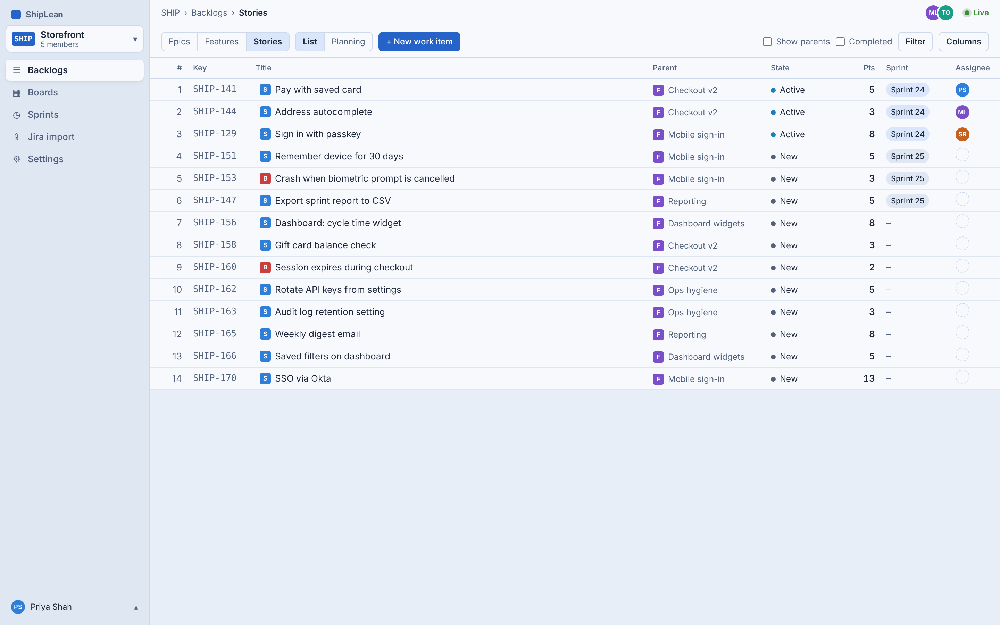
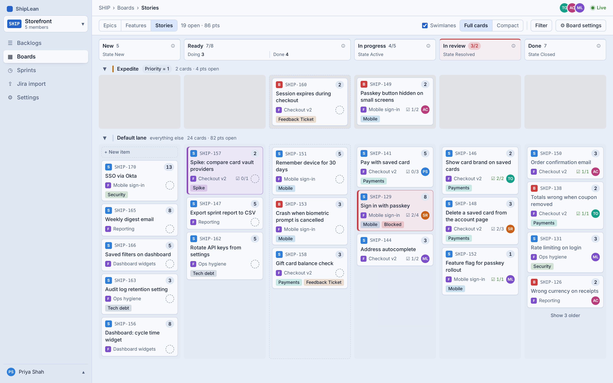
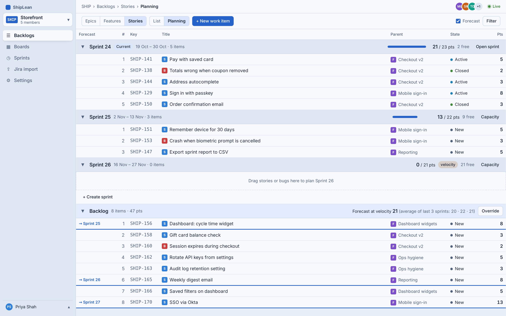
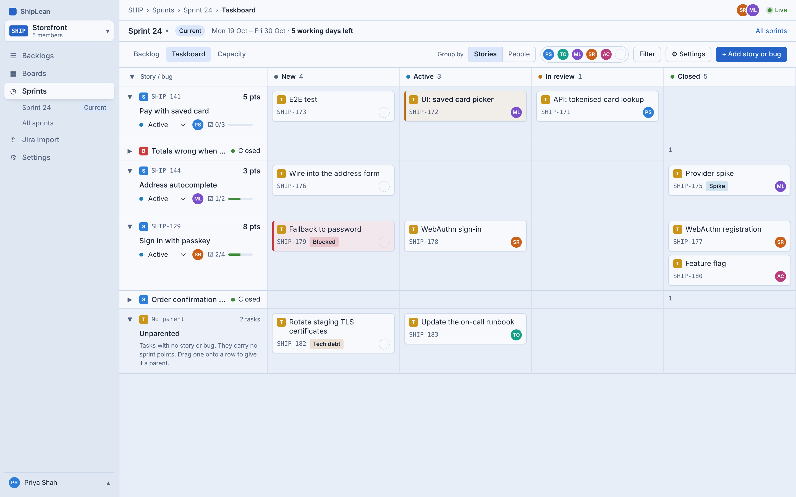

<p align="center">
  <a href="https://github.com/ShipLean/ShipLean">
    <picture>
      <source media="(prefers-color-scheme: dark)" srcset="design/logo/shiplean-logo-on-dark.svg">
      
    </picture>
  </a>
</p>

<p align="center">
  Lean planning tools for software teams: backlogs, boards, sprints and a sprint taskboard, built around one work item model.
</p>

<p align="center">
  <a href="https://github.com/ShipLean/ShipLean/actions/workflows/ci.yml"></a>
  <a href="https://github.com/ShipLean/ShipLean/actions/workflows/docker-publish.yml"></a>
  <a href="https://github.com/ShipLean/ShipLean/pkgs/container/shiplean"></a>
</p>

---

ShipLean is a self-hosted, single-tenant planning tool in the spirit of the classic Agile board tools, with the parts a small team actually uses and none of the process machinery. One Postgres database, one container, cookie sign-in, light and dark themes, and a compact UI that keeps a lot of rows on screen.

## What you get

- **Backlogs** at three levels: Stories, Features and Epics. A ranked list with add-at-top, a tree mode that shows parents, a filter builder, column options, and points and progress rolled up from the stories and bugs below.
- **Boards** over each backlog level: columns mapped to each type's states, WIP limits, split columns, a definition of done per column, swimlanes, card fields, style rules, tag colours and annotations. The Features and Epics boards roll children up onto the cards and can lane by Epic.
- **Sprints**: a planning mode with sprint sections stacked above the backlog, a forecast that fills each future sprint's remaining room, capacity entered per person and compared as a team total, a sprint backlog with burndown, a velocity chart, and a roll-over prompt for unfinished work at sprint end.
- **Taskboard**: the sprint's stories and bugs against the Task states, grouped by stories or by people, with its own styles and tag colours.
- **Work items** with fields, tasks, a Markdown discussion, links, attachments and a revision history. Saving over a teammate's change is a conflict with the changes since your revision, never a silent overwrite.
- **Project settings**: a permanent 2–4 letter project key (`SHIP-123`), working days, your own states per work item type, members, and the velocity window used by the forecast.
- **Jira import**: one Jira project into one ShipLean project in five steps, with mapping, progress, an error log and re-runs. Jira Epics become Features; issue numbers are kept.
- **Instance admin**: users, one-time passwords, lockouts, instance admins, who may create projects, and a first admin bootstrapped from the environment.
- **Agents over MCP**: an AI agent (Claude Code, Cursor, Claude Desktop) connects to `/mcp`, the person approves it in the browser, and the agent reads and writes work items under its own name. See [Connecting an agent](docs/agents.md).

## Screens

The screenshots below are the reference designs, not captures of the running app. They live in [`design/screens/`](design/README.md) as single HTML files that open straight in a browser, each with light and dark screenshots (shown here by your browser's colour scheme).

| Stories backlog | Stories board |
|---|---|
| <picture><source media="(prefers-color-scheme: dark)" srcset="design/screens/backlog.dark.png"></picture> | <picture><source media="(prefers-color-scheme: dark)" srcset="design/screens/board.dark.png"></picture> |

| Sprint planning | Sprint taskboard |
|---|---|
| <picture><source media="(prefers-color-scheme: dark)" srcset="design/screens/planning.dark.png"></picture> | <picture><source media="(prefers-color-scheme: dark)" srcset="design/screens/taskboard.dark.png"></picture> |

Every screen, in both themes, is in the [design README](design/README.md#shiplean-design-system).

## The model in one paragraph

A **project** owns a team, a backlog, boards and sprints; access is checked per project, and instance admins get no implicit access. A **work item** is an Epic, Feature, Story, Bug or Task. Epics hold Features; Features hold Features, Stories and Bugs; Stories and Bugs hold Tasks. Every type has its own **states**, each in one **category** (Proposed, In Progress, Resolved, Completed or Removed), so boards map columns to states and the rest of the app reasons about categories. Estimates are story points only. Sprints are flat time boxes with capacity per person. Nothing is hard-deleted: Removed is a state, everything else is archived. The full model, and the decisions behind it, are in [issue #1](https://github.com/joeldickson/ShipLean/issues/1).

## Run it

The published image is `ghcr.io/shiplean/shiplean` (`latest` and one tag per commit on `main`). It serves the API and the SPA on port 8080 and applies the database schema and migrations at startup.

The quickest way up is the compose file, which adds a `postgres:18` service and the volumes:

```bash
git clone https://github.com/ShipLean/ShipLean.git
cd ShipLean
SHIPLEAN_ADMIN_EMAIL=you@example.com SHIPLEAN_ADMIN_PASSWORD='choose-one' \
  docker compose -f src/docker-compose.yml up --build
```

Then open <http://localhost:8080> and sign in as that admin. To connect an agent, follow [`docs/agents.md`](docs/agents.md). Remove the two `SHIPLEAN_ADMIN_*` variables once you have signed in; they only matter while no user is an instance admin. `GET /health` names the running commit.

To sign people in through an identity proxy instead of passwords, set the `SHIPLEAN_AUTH_PROXY_*` settings below and read [Behind an identity proxy](docs/auth.md#behind-an-identity-proxy). Then `SHIPLEAN_ADMIN_EMAIL` alone is enough: that person becomes the first instance admin when they first arrive through the proxy.

### Configuration

Everything is an environment variable prefixed `SHIPLEAN_`.

| Variable | What it does |
|---|---|
| `SHIPLEAN_DB_CONNECTION` | Npgsql connection string. Required. |
| `SHIPLEAN_DB_MIGRATE` | Apply `db/schema` and `db/migrations` at startup. Default `true`. |
| `SHIPLEAN_ADMIN_EMAIL`, `SHIPLEAN_ADMIN_PASSWORD` | Create (or find) this user and make them an instance admin when no admin exists. Behind an identity proxy the email alone is enough (the password is ignored with a warning): that user is made an instance admin at startup if they exist, or at their first proxy sign-in if not. |
| `SHIPLEAN_BLOB_ROOT` | Folder for attachments and profile photos when neither blob connection below is set. Default `data/blobs` under the app folder; `/data/blobs` in compose, on a named volume. |
| `SHIPLEAN_BLOB_DB_CONNECTION` | Npgsql connection string: keep attachments and photos in a `blob` table instead of a folder. It can be the same string as `SHIPLEAN_DB_CONNECTION` or another database; the table is created there at startup when `SHIPLEAN_DB_MIGRATE` is on. |
| `SHIPLEAN_BLOB_S3_CONNECTION` | Keep attachments and photos in an S3 bucket (AWS, or anything that speaks the S3 API: Cloudflare R2, Backblaze B2, RustFS). Settings separated by `;`: `bucket` (required), `region` or `serviceUrl` (one is required), `accessKey` and `secretKey` (both or neither; leave them out to use the AWS default credentials: IAM role, environment, profile), `forcePathStyle` (`true` for most non-AWS services), `prefix` (put in front of every key). Example: `bucket=shiplean;region=ap-southeast-1;prefix=prod/`. The bucket must exist. |
| `SHIPLEAN_ATTACHMENT_MAX_BYTES` | Largest attachment accepted, in bytes (uploads and imports). Default `26214400` (25 MiB). |
| `SHIPLEAN_ATTACHMENT_MAX_ITEM_BYTES` | Most attachment bytes one work item may hold, counting live files only (a replaced file stops counting). Default `262144000` (250 MiB). A file is still held to `SHIPLEAN_ATTACHMENT_MAX_BYTES`. |
| `SHIPLEAN_GITHUB_TOKEN` | A GitHub token that can read pull requests and issues. With it, a pull request or issue link on a Feature shows its live title and state, including in private repositories; without it only public ones can be read. It is sent only to an https API address. |
| `SHIPLEAN_GITHUB_API_URL` | The GitHub API address, for GitHub Enterprise Server (`https://github.example.com/api/v3`). Default `https://api.github.com`. |
| `SHIPLEAN_GITLAB_URL` | Your GitLab's address (`https://gitlab.example.com`). Merge request and issue links on that host show live state; links to other GitLab hosts stay plain page links. Unset, GitLab links are not read. |
| `SHIPLEAN_GITLAB_TOKEN` | A GitLab token that can read merge requests and issues. Used only with `SHIPLEAN_GITLAB_URL`, and sent only when that URL is https. |
| `SHIPLEAN_TRUSTED_PROXIES` | Comma-separated addresses or CIDRs of the reverse proxy whose forwarded client address and scheme are believed. Compose trusts its own network by default. |
| `SHIPLEAN_FORWARDED_FOR_HEADER` | The header carrying the client address when the proxy sets its own (`CF-Connecting-IP` behind Cloudflare). Default `X-Forwarded-For`. |
| `SHIPLEAN_AUTH_PROXY_TOKEN_HEADER` | Turns on proxy sign-in (recommended mode). The request header that carries the proxy's signed JWT: `X-Forwarded-Access-Token` (oauth2-proxy), `Cf-Access-Jwt-Assertion` (Cloudflare Access), `X-Pomerium-Jwt-Assertion` (Pomerium). `Authorization` means a `Bearer` token. The token is verified on every request. Needs `SHIPLEAN_AUTH_PROXY_TOKEN_ISSUER`. Unset, sign-in stays email and password. Details: [`docs/auth.md`](docs/auth.md#behind-an-identity-proxy). |
| `SHIPLEAN_AUTH_PROXY_TOKEN_ISSUER` | Required with the token header. The token's `iss` must match it. Keys come from `<issuer>/.well-known/openid-configuration`. Absolute `https` URL (`http` only for loopback). |
| `SHIPLEAN_AUTH_PROXY_TOKEN_JWKS_URL` | Optional. A key-set URL for issuers with no discovery document (Cloudflare Access: `https://<team>.cloudflareaccess.com/cdn-cgi/access/certs`). Overrides discovery. Same URL rule as the issuer. |
| `SHIPLEAN_AUTH_PROXY_TOKEN_AUDIENCE` | Optional. When set, the token's `aud` must contain it. |
| `SHIPLEAN_AUTH_PROXY_EMAIL_CLAIM` | The claim holding the email. Default `email`. |
| `SHIPLEAN_AUTH_PROXY_NAME_CLAIM` | The claim holding the name. Default `name`. When it is missing, a new user's name is the part of the email before the `@`. |
| `SHIPLEAN_AUTH_PROXY_EMAIL_HEADER` | Plain-header mode, for proxies that send no token (Authelia's `Remote-Email`). Turns on proxy sign-in. Safe only when nothing but the proxy can reach ShipLean; believed only from loopback and `SHIPLEAN_TRUSTED_PROXIES`. Don't set it together with the token header. |
| `SHIPLEAN_AUTH_PROXY_NAME_HEADER` | Optional, plain-header mode only. The header holding the name (`Remote-Name`). |
| `SHIPLEAN_AUTH_PROXY_SIGN_OUT_URL` | Optional. Where "Sign out" goes: a path such as `/oauth2/sign_out` or an absolute http(s) URL. Unset, "Sign out" is hidden. |
| `SHIPLEAN_MCP_GATEWAY_EMAIL_HEADER` | The request header that carries the caller's email on `/mcp`, for example `x-user-email`. Unset, `/mcp` accepts only a ShipLean agent bearer token and ignores that header. Set, a request with no bearer and a single non-blank value is that person: ShipLean finds or creates the user (a new name is the part of the email before `@`, and a later call does not overwrite a name they have changed) and the call can use every tool. Project membership still decides which boards they can see; someone who is not on a project gets `not_found`. A valid bearer token still works. No header and no token is still 401, and a blank header counts as no header. **Trust:** the variable only turns this on. Set it only when a sidecar, policy proxy or ingress in front of ShipLean writes the header and strips any copy the client sent, and no client can reach `/mcp` directly. A client that can set the header can act as any email. |
| `SHIPLEAN_REDIS_CONNECTION` | StackExchange.Redis connection string (`redis:6379,password=…`). Set it when more than one instance runs: SignalR uses Redis as its backplane so live events reach clients on every instance, and presence and member removals are shared through it. Every key and channel starts with the connection string's `channelPrefix` (default `shiplean`), so give each deployment on a shared Redis its own. Unset, everything stays in process. See [`docs/events.md`](docs/events.md#running-more-than-one-instance). |
| `SHIPLEAN_SEQ_URL`, `SHIPLEAN_SEQ_API_KEY` | Ship logs to Seq as well as the console. |
| `SHIPLEAN_GITHUB_WEBHOOK_SECRET`, `SHIPLEAN_GITLAB_WEBHOOK_SECRET` | Turn on `POST /api/webhooks/github` and `/api/webhooks/gitlab` (404 while unset), and the secret the provider's webhook must send. Pull and merge requests then link to the Stories, Tasks and Bugs their title or branch names, show their state on the link, and close the item on merge. Setup and rules: [`docs/webhooks.md`](docs/webhooks.md). |
| `SHIPLEAN_JIRA_ALLOW_LOCAL_ENDPOINTS` | `true` lets a Jira import address be a local one, and also lets it use plain `http` (to any host, so the token travels unencrypted). Leave it off unless Jira is on your own network. |
| `SHIPLEAN_EMBEDDINGS` | `on` (default) or `off`. Search ranks by meaning as well as by words when a model is loaded; `off` keeps search lexical (words only). |
| `SHIPLEAN_EMBEDDINGS_MODEL_PATH` | Folder holding the embedding model (`model.onnx`, `sentencepiece.bpe.model`, `shiplean-model.json`). The image sets `/app/models/multilingual-e5-small`. Unset (a source build), or unreadable, search stays lexical and `/health` says why. `scripts/fetch-embedding-model.sh <dir>` downloads the pinned model into a folder. |
| `SHIPLEAN_SEARCH_CHUNK_CHARS`, `SHIPLEAN_SEARCH_CHUNK_OVERLAP` | How long a text is split into pieces for indexing, and how much neighbouring pieces overlap, in characters. Default `1200` and `150`. |
| `SHIPLEAN_SEARCH_CUTOFF` | The lowest similarity (0 to 1) for a meaning match to count. Default `0.55`. |
| `SHIPLEAN_SEARCH_TOP_PER_LIST`, `SHIPLEAN_SEARCH_RRF_K` | Hits kept from each ranked list before they are merged (default `100`), and the reciprocal-rank-fusion constant used to merge them (default `60`). |
| `SHIPLEAN_SEARCH_BATCH` | Texts embedded per model call. Default `32`. |
| `SHIPLEAN_SEARCH_THREADS` | ONNX Runtime intra-op threads for embedding. Default `1`. |
| `SHIPLEAN_SEARCH_FIRST_PASS_SECONDS`, `SHIPLEAN_SEARCH_INTERVAL_SECONDS` | The background indexer's first pass after start, and the gap between passes, in seconds. Default `20` and `60`. |
| `SHIPLEAN_PORT`, `SHIPLEAN_PG_PORT`, `POSTGRES_PASSWORD` | Compose only: the host ports and the database password. |

**Integrations in the app.** `SHIPLEAN_GITHUB_TOKEN`, `SHIPLEAN_GITLAB_URL` and `SHIPLEAN_GITLAB_TOKEN` are defaults; `SHIPLEAN_GITHUB_API_URL` is set only by the environment. Settings saved under Instance settings → Integrations override the three defaults (a saved GitLab URL brings its own token, so the environment's token is not mixed with it), and clearing the saved GitLab URL brings the environment's pair back. A token is only sent to an https address: the settings refuse to save one for an http URL.

**Where blobs go.** There's no setting that names the store: the first connection that is set wins. `SHIPLEAN_BLOB_S3_CONNECTION` means S3, else `SHIPLEAN_BLOB_DB_CONNECTION` means Postgres, else the `SHIPLEAN_BLOB_ROOT` folder. Startup logs which store it picked and why, with the password and secret key left out, and warns when both connections are set. Use Postgres or S3 when more than one instance runs or there is no persistent disk. Changing the store later doesn't move what's already stored, and nothing is ever deleted from any of them.

Sign-in is a cookie (`shiplean.auth`, 14-day sliding, `Secure` over https), so put a reverse proxy with TLS in front of it and tell ShipLean where that proxy connects from. The details, including lockout, rate limits and CSRF, are in [`docs/auth.md`](docs/auth.md).

## Develop

You need the .NET 10 SDK, Node 24 with pnpm (via corepack), and either Docker or a local Postgres 18.

```bash
scripts/db-reset.sh                                   # dev database from db/ (PGHOST/PGPORT/PGUSER/PGPASSWORD)
dotnet run --project src/ShipLean.WebApi              # API on :5113, connection from appsettings.Development.json
cd src/ShipLean.Client && pnpm install && pnpm run dev # SPA on :3000, proxies /api to :5113
```

Checks, from the repository root:

```bash
dotnet build src/ShipLean.slnx -c Release                                     # warnings are errors
dotnet test src/ShipLean.UnitTest                                             # pure helpers and architecture guard rails
dotnet test src/ShipLean.WebApi.Tests                                         # API tests: the real app over a fresh Postgres
dotnet test src/ShipLean.AcceptanceTests                                      # Playwright against the real app and built SPA
cd src/ShipLean.Client && pnpm run format:check && pnpm run lint && pnpm run typecheck && pnpm test
cd src/ShipLean.Client && pnpm run test-ct                                    # Playwright component tests
```

API and acceptance tests start a `postgres:18` Testcontainers container unless `SHIPLEAN_TEST_DB` points at a server. Each test class clones a template database and runs its own Kestrel host, so classes run in parallel and never share state. The model is written up in [`docs/testing.md`](docs/testing.md).

### How it is built

| Layer | Choice |
|---|---|
| API | ASP.NET Core on .NET 10. Controllers are one-liners over feature services; every error is an `ApiError { error, code }` (plus `field` when one request field is at fault). |
| Data | Postgres 18 through Npgsql and Dapper with parameters. Schema, additive migrations and seed under [`db/`](db/README.md), applied by DbUp. No ORM. |
| Client | React SPA with Vite, built into the API's `wwwroot`. Inter, design tokens from [`design/tokens.css`](design/tokens.css), light and dark, compact by default. |
| Real time | Writes go through REST; boards, backlogs and the taskboard subscribe to project events for presence and live updates. |
| Time | UTC everywhere. The clock is `TimeProvider` (the static clocks are banned at build time) and timestamps travel with a server-formatted label. |
| Deletes | None. Rows are archived or moved to a Removed state, and a guard-rail test keeps it that way. |

| Path | What |
|---|---|
| `src/ShipLean.WebApi` | Host, controllers, error mapping, health. Serves the SPA. |
| `src/ShipLean.Application` | Commands and queries per feature, the database helper, identity. |
| `src/ShipLean.Contracts` | Interfaces, DTOs and events shared across features. |
| `src/ShipLean.Core` | Dependency-free helpers (dates, labels). |
| `src/ShipLean.Client` | The React SPA. |
| `src/ShipLean.TestSupport`, `*.Tests`, `ShipLean.AcceptanceTests`, `ShipLean.UnitTest` | Fixtures, API tests, browser tests, unit and guard-rail tests. |
| `db/` | Schema, migrations, seed. |
| `design/` | Tokens, the logo, the reference screens and their screenshots. |
| `docs/` | Testing, auth, events, navigation, MCP and agent write-ups. |

The house rules for anyone (or any agent) working in the repo are in [`AGENTS.md`](AGENTS.md).

## Where things are decided

- [Issue #1](https://github.com/joeldickson/ShipLean/issues/1): the work item model and the v1 decisions.
- [Issue #7](https://github.com/joeldickson/ShipLean/issues/7): the build plan v1 was built from.
- [`design/README.md`](design/README.md): the design system, every reference screen, and the decisions made while designing them.
- [`docs/`](docs/README.md): testing, sign-in and access, project events, navigation, MCP and connecting an agent.

## Logo

The mark is a boat: three backlog rows stacked as a sail, widening down to the hull, on the brand gradient (teal to blue on light, mint to cyan on dark). The files in [`design/logo/`](design/logo/) are copies of the brand assets kept with the [shiplean.app](https://github.com/ShipLean/shiplean.app) website: a mark for each theme, the mark with the wordmark for each theme, a 512px PNG for avatars, and a favicon that switches with the visitor's theme. The wordmark is live SVG text in Inter 700, so outline it before sending it to print.

<p align="center">
  <picture>
    <source media="(prefers-color-scheme: dark)" srcset="design/logo/shiplean-mark-dark.svg">
    
  </picture>
</p>
