# Feature timeline (SHIP-1465)

A look back at how a Feature was delivered, so we can find what slowed it down once execution started. The Feature page shows four key dates. They open a full-screen Gantt chart of the execution, drawn after the fact from task state history. Agents get the same information as JSON from a new MCP tool, `feature_timeline`.

Mock-ups, not built. Decisions D1–D14 were settled by Joel on 14 Nov 2026. D15 is open.

## Screens

| File | What it shows |
|---|---|
| `screens/feature.html?timeline` | The **Timeline** section on the Feature page: the four key dates and **Open timeline**. Nothing else (D1). |
| `screens/feature-timeline.html` | The full-screen timeline at `/p/<project>/items/<key>/timeline`. |
| `screens/timeline-data.js` | Sample history for two Features, and `TL.build(key)`: the one view model the chart, the rail, the Feature page and the JSON view all use. It plays the part of the server-side builder. |
| `screens/timeline.css` | The key dates strip and legend swatches, shared by both screens. |

States of `feature-timeline.html`:

| Query | State |
|---|---|
| *(none)* | SHIP-99 *Coupons v2*, finished: critical path outlined, grouped by Stories, Fit zoom |
| `?select=SHIP-192` | A task selected: its history, its reviews, what it waited on and held up, its retro points |
| `?key=SHIP-101` | *Checkout v2*, still running: open bars run to now, no critical path, a list of what hasn't started |
| `?group=people` / `?group=tasks` | Grouped by person (the agent gets its own group), or a flat list of tasks |
| `?zoom=days` | A fixed width per day, scrolling sideways |
| `?view=json` | What `feature_timeline` returns for the same Feature, and how the chart maps to it |
| `?deps=off`, `?cp=off` | Dependencies or the critical path hidden |

| Screen | Light | Dark |
|---|---|---|
| Feature page, Timeline section | 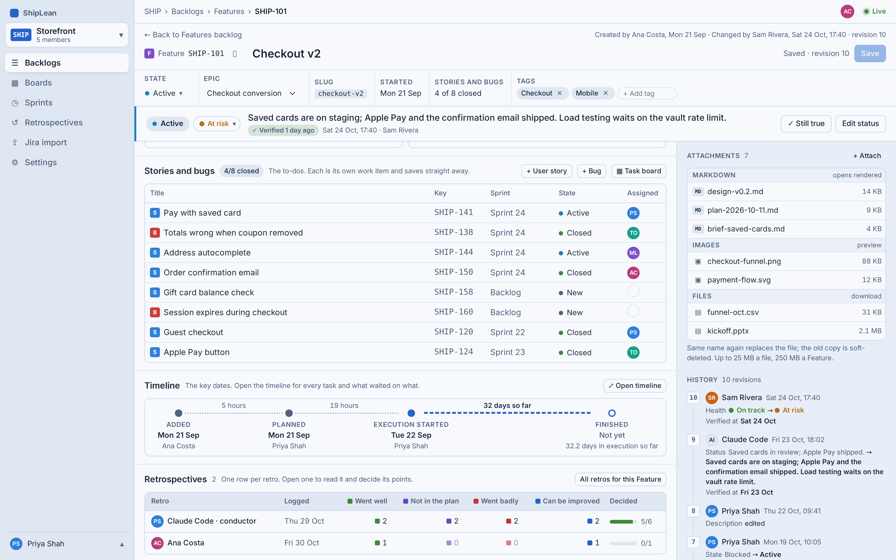 | 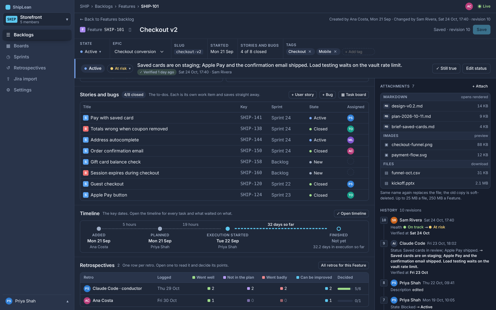 |
| Finished Feature | 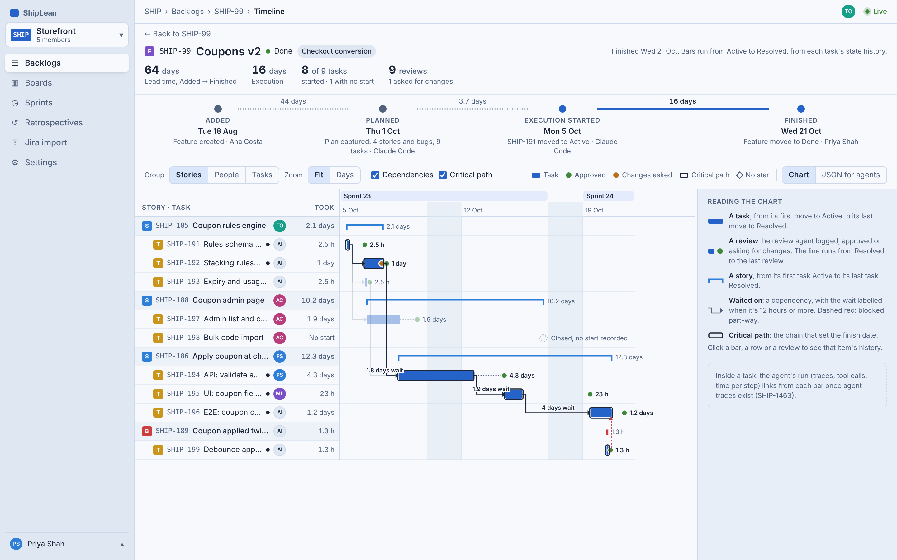 | 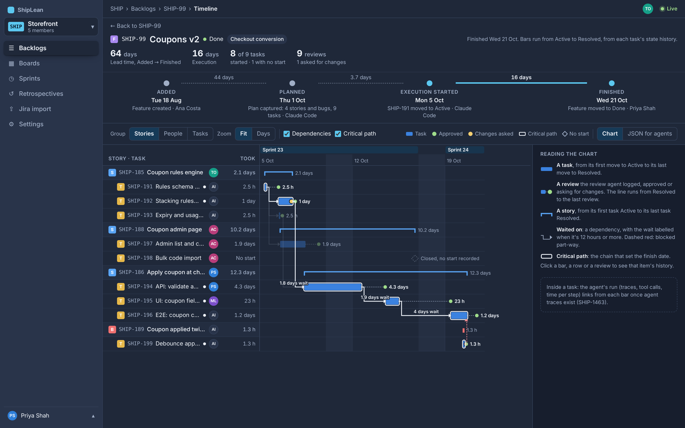 |
| A task selected | 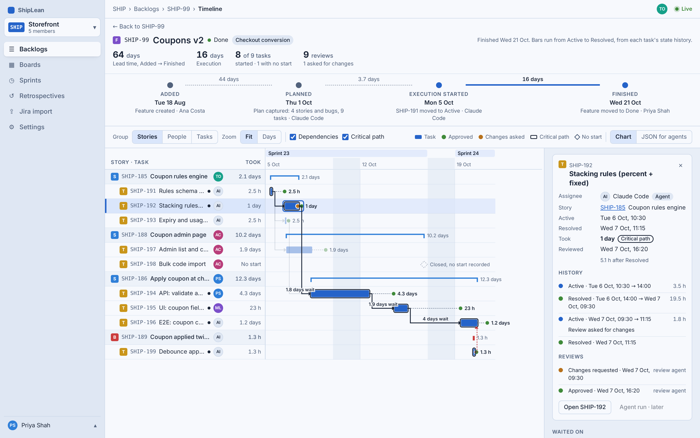 | 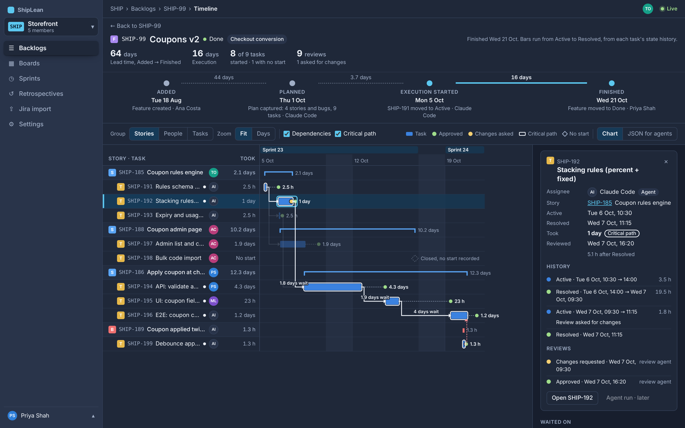 |
| Still running | 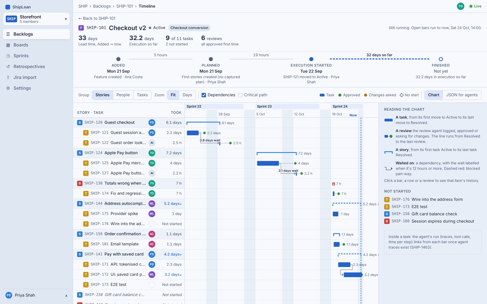 | 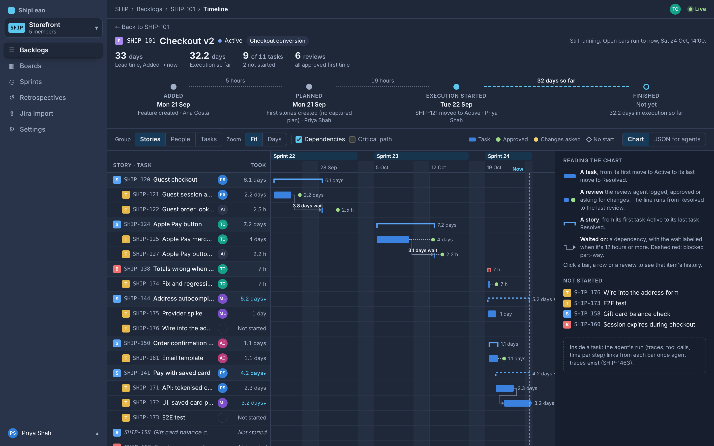 |
| Grouped by People | 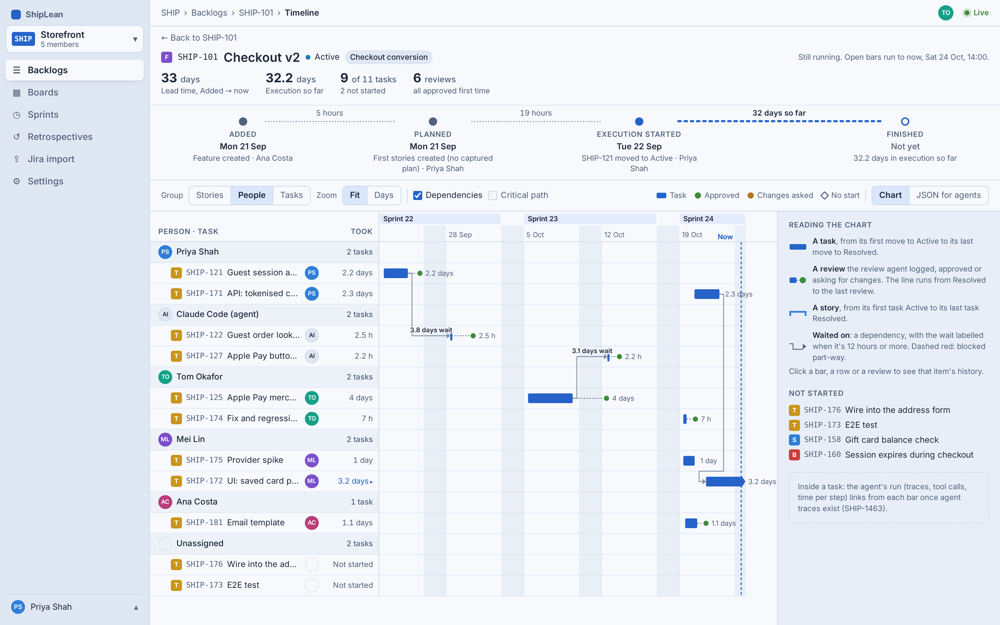 | 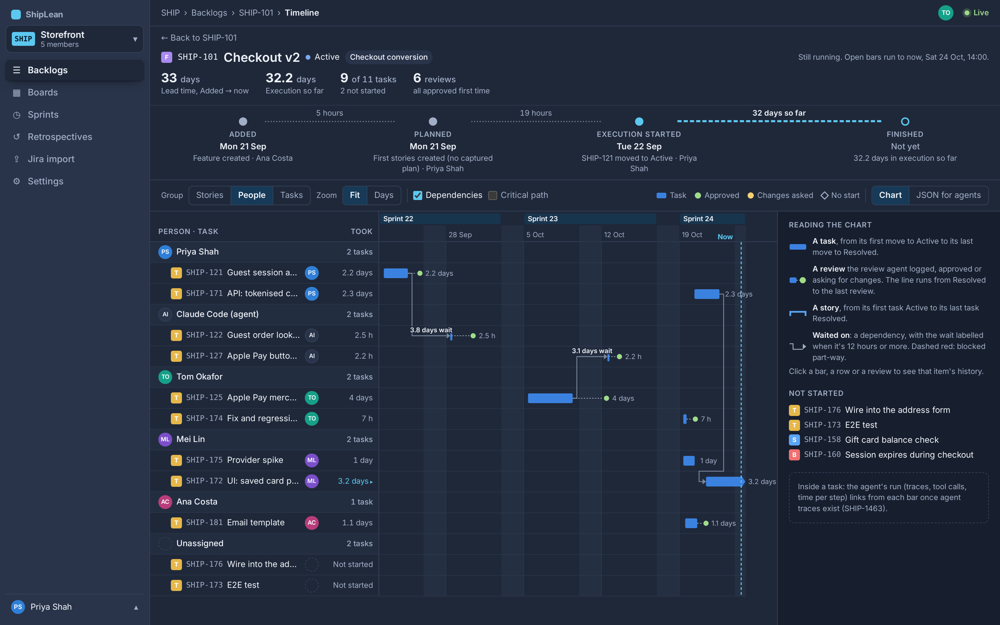 |
| Days zoom, an item with no history | 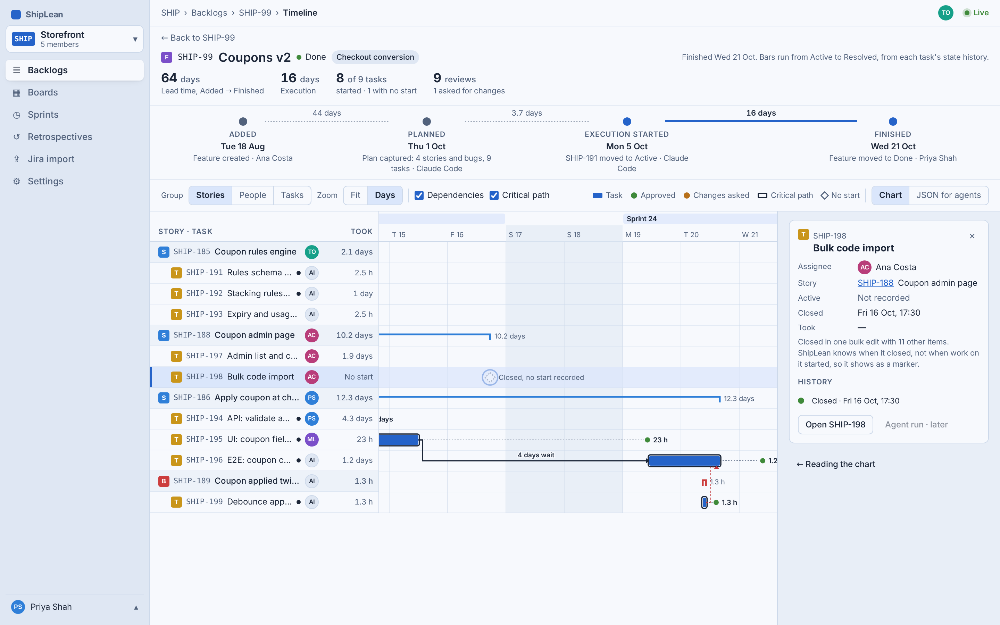 | 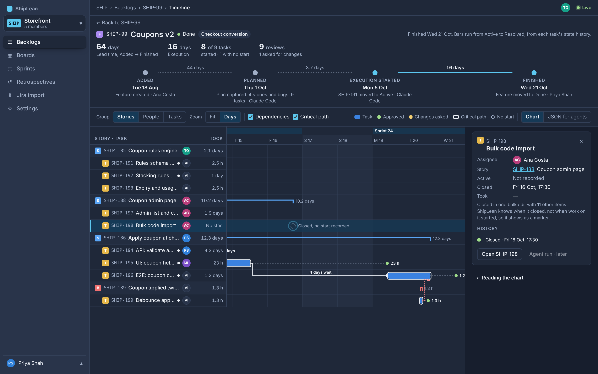 |
| JSON for agents | 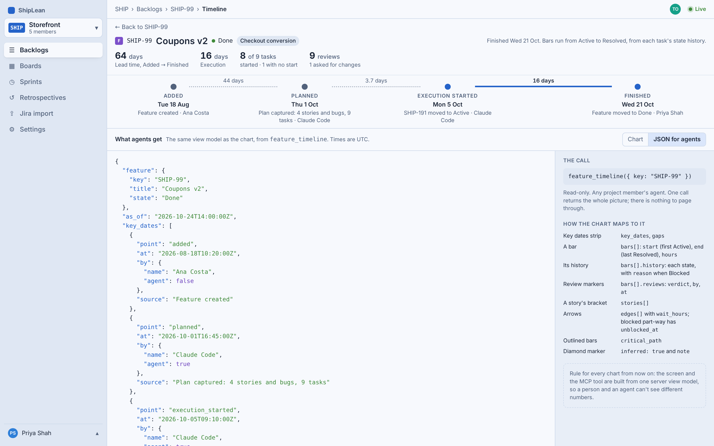 | 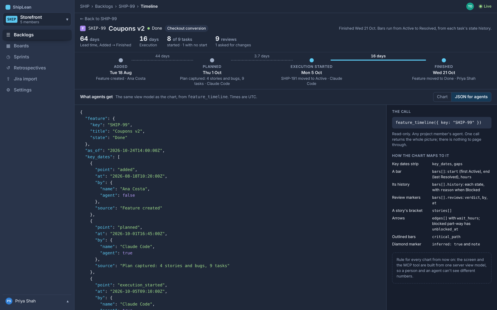 |

## How the chart is read

- **Key dates:** Added (Feature created), Planned (plan captured, or the first stories created), Execution started (first task to Active) and Finished (Feature to Done). The gaps between them are labelled but not drawn to scale. The execution gap is the one the chart shows.
- **A task:** one solid bar from its first move to Active to its last move to Resolved (D2, D5). Blocked time and reopenings sit inside the bar; click the bar to see them.
- **A story or bug:** a bracket from its first task going Active to its last task going Resolved (D3).
- **A review:** a dot after the task's bar, green when approved and amber when changes were requested, joined to the bar by a dashed line from Resolved to the last review (D15).
- **Dependencies:** an arrow from the predecessor's Resolved to the task's Active. The source is blocked_by and predecessor links, plus later waves in a captured plan. A wait of 12 hours or more is labelled. An item that blocked a task part-way gets a dashed red arrow to the moment the task went back to Active (D6).
- **Critical path:** once the Feature is Done, the outlined chain. It walks back from the last task to resolve, through the predecessor that released each task (the latest one to resolve before it went Active), plus anything that blocked a task on that chain. A toggle hides it (D7).
- **No history:** an item closed with no start recorded (a bulk edit, say) is a diamond at the moment it closed, labelled *Closed, no start recorded*, never a made-up bar (D4).
- **Time:** calendar time with weekends shaded, because agents work at weekends (D9). Sprint bands run along the top.
- **No findings:** ShipLean shows the chart and doesn't interpret it. People and agents draw their own conclusions (D8).

## Where the data comes from

| Value | Source |
|---|---|
| Added | Work item created at |
| Planned | `capture_plan` time, else when the first child was created |
| Execution started | The first task's first move to an Active-category state, or `pick_up`, whichever came first |
| Finished | The Feature's move to a Completed-category state |
| Task start / end | State history: first move to Active; last move to Resolved, or to Closed when it skipped Resolved |
| Task history | State history, with the reason when Blocked |
| Reviews | Review events (D15), new |
| Dependencies | `blocked_by` / predecessor links and plan waves |
| Not started | Children with no move to Active |

Pull requests aren't used at task level: one pull request holds many tasks, so its merge is review level, not task level (D2). The only new data is the review event (D15). Everything else is in history ShipLean already keeps (D13).

## MCP: `feature_timeline(key)`

Read-only. It returns the same view model the page uses, built by the same server code (D11). Times are ISO 8601 UTC, and people have an `agent` flag. An abbreviated sample (see `?view=json` for the whole response):

```json
{
  "feature": { "key": "SHIP-99", "title": "Coupons v2", "state": "Done" },
  "as_of": "2026-10-24T14:00:00Z",
  "key_dates": [{ "point": "added", "at": "2026-08-18T10:20:00Z", "by": { "name": "Ana Costa", "agent": false }, "source": "Feature created" }],
  "gaps": [{ "from": "added", "to": "planned", "days": 44.3, "so_far": false }],
  "execution": { "start": "2026-10-05T09:10:00Z", "end": "2026-10-21T10:05:00Z", "calendar_days": 16 },
  "critical_path": ["SHIP-191", "SHIP-192", "SHIP-194", "SHIP-195", "SHIP-196", "SHIP-199"],
  "stories": [{ "key": "SHIP-185", "type": "story", "title": "Coupon rules engine", "start": "…", "end": "…", "hours": 50.1, "tasks": ["SHIP-191", "SHIP-192", "SHIP-193"] }],
  "bars": [{
    "key": "SHIP-192", "type": "task", "title": "Stacking rules (percent + fixed)", "parent": "SHIP-185",
    "assignee": { "name": "Claude Code", "agent": true }, "state": "resolved",
    "start": "2026-10-06T10:30:00Z", "end": "2026-10-07T11:15:00Z", "hours": 24.8, "inferred": false, "on_critical_path": true,
    "history": [
      { "state": "active", "from": "2026-10-06T10:30:00Z", "to": "2026-10-06T14:00:00Z", "hours": 3.5 },
      { "state": "resolved", "from": "2026-10-06T14:00:00Z", "to": "2026-10-07T09:30:00Z", "hours": 19.5 },
      { "state": "active", "from": "2026-10-07T09:30:00Z", "to": "2026-10-07T11:15:00Z", "hours": 1.8, "reason": "Review asked for changes" },
      { "state": "resolved", "from": "2026-10-07T11:15:00Z" }
    ],
    "reviews": [
      { "at": "2026-10-07T09:30:00Z", "verdict": "changes_requested", "by": { "name": "Claude Code", "agent": true } },
      { "at": "2026-10-07T16:20:00Z", "verdict": "approved", "by": { "name": "Claude Code", "agent": true } }
    ]
  }],
  "edges": [
    { "from": "SHIP-191", "to": "SHIP-192", "kind": "depends", "wait_hours": 22.8, "on_critical_path": true },
    { "from": "SHIP-199", "to": "SHIP-196", "kind": "blocked", "wait_hours": null, "unblocked_at": "2026-10-20T14:40:00Z", "on_critical_path": true }
  ],
  "not_started": [],
  "links": { "ui": "/p/SHIP/items/SHIP-99/timeline", "agent_runs": "comes with SHIP-1463" }
}
```

The rule from Joel's memo applies to every chart from now on: a chart shown to people must also be available to agents as JSON with the same information.

## Review events (D15, open)

Recommended: a review event, not a state. Each time the review agent reviews a task, it logs `{ item, verdict: approved | changes_requested, note? }`. One task can have any number, one per review round. Each event is a dot on the chart and a row in the task's history. The review agent's prompt tells it to log one. The alternatives are a *Reviewed* Task state after Resolved (the bar would then run to Reviewed), or recording review only per story or pull request.

## What gets built

1. **Timeline view model:** one query that builds the timeline for a Feature from state history, links, plan waves and review events. Items 3 and 4 both use it.
2. **Review events (D15):** the event, the MCP call or parameter that records it, and the line in the review agent's prompt.
3. **MCP tool `feature_timeline(key)`:** read-only, returns the view model, mentioned in the planning guide, its response shape pinned in a test.
4. **Timeline page:** `/p/<project>/items/<key>/timeline`. Our own SVG chart, no Gantt library (D10). Grouping, zoom, toggles, the rail and the JSON view.
5. **Key dates on the Feature page:** a Timeline section. It also shows under 900px, without Open timeline. Nothing in the phone app (D12).
6. **Analytics (D14):** timeline opened (from the Feature page or a link) and bar selected, weekly, against page views of finished Features in the same weeks; `feature_timeline` calls against `get_work_item` calls on Features, per week.

## Decisions

| # | Question | Answer | |
|---|---|---|---|
| D1 | Where it lives | A Timeline section on the Feature page that opens a full-screen page. Key dates only: no thumbnail, no finding | confirmed |
| D2 | Where a task bar starts and ends | First move to Active to last move to Resolved, from state history. Not pull requests | changed |
| D3 | What a story's bar shows | First task Active to last task Resolved | changed |
| D4 | Items with no history | A diamond at the moment it closed, labelled *Closed, no start recorded* | confirmed |
| D5 | Waiting drawn differently from work | One solid bar per task | changed |
| D6 | Where the arrows come from | Links plus plan waves; dashed red when blocked part-way; waits of 12 h or more labelled | confirmed |
| D7 | Critical path | Once the Feature is Done, with a toggle | confirmed |
| D8 | Findings | Just the chart; no computed findings | changed |
| D9 | Time scale | Calendar time, weekends shaded; Fit and Days zoom | confirmed |
| D10 | Gantt library | Our own SVG, no new dependency | confirmed |
| D11 | MCP twin | `feature_timeline(key)`, same builder as the page; part of the plan | confirmed |
| D12 | Phones | The key dates show under 900px; nothing in the phone app | confirmed |
| D13 | Extra logging by agents | None beyond the review event (D15) | confirmed |
| D14 | Measuring it | As in item 6 above | confirmed |
| D15 | How review is recorded per task | Recommended: a review event per review round, logged by the review agent | **open** |

## Not in this Feature

- **The agent's run inside a task:** Aspire / OpenTelemetry traces, SHIP-1463. The rail has a disabled *Agent run · later* button for it.
- **The code behind a bar:** diffs per task, SHIP-1460.
- **Comparing Features:** review wait and blocked time across many Features would belong in Retrospectives › Insights.
