# SHIP-744: Prompts (view and override built-in prompts per project)

Mock-up, not built. Decisions D1–D11 were settled by Joel on 21 Nov 2026. D12–D14 are recommended and wait for his confirmation on SHIP-744. Screen: [`screens/prompts.html`](screens/prompts.html).

ShipLean sends agents built-in Markdown prompts: the planning guide parts, the sprint demo recipe and the issue proposal. This page lists them in the order agents meet them and says when each one runs. A project admin can save a custom version, which agents in that project then get instead of the built-in one.

> **Moved and re-navigated by SHIP-2280 (24 Nov 2026).** The page is now **Ways of working**, a top-level side-menu item under Inspection, not a Project settings tab, and the stage strip is its only stage picker (the list with its numbered rail is gone). See [Ways of working navigation (SHIP-2280)](#ways-of-working-navigation-ship-2280) below; it overrides D1, D14 and the List bullet under Screen.

Images: `screens/prompts*.png` (1440 × 900), in light and dark. `screens/prompts-phone*.png` (390 × 844) show the narrow layout, taken with headless Chrome at `--window-size=390,844` because `screenshots.sh` can't shoot that narrow. The variants are listed in `screenshots.sh`. The prompt texts in the mock-up are the real built-in ones, held in `screens/prompts-data.js` (made by `screens/prompts-data.mjs` from `main`).

## Where it lives

**Project settings › Prompts** (D1) is the last tab, after Demos. It is its own page, `/p/SHIP/settings/prompts`. Each prompt is saved on its own and versioned, so this tab isn't part of the settings draft or its Save button. Demos already works this way (D12).

Project admins can edit prompts. Members can read every prompt, its facts and its banners, but the controls that change anything are hidden and a banner names who to ask (D2).

## Screen

- **Stage strip.** Seven stages run across the top: Intake → Shape → Plan → Build → Review → Retro → Sprint demo. Each shows its number of prompts and how many are custom. Click a stage to jump the list to it.
- **List** (left). Prompts are grouped by stage on a numbered rail. Each stage has one line on when it happens. Each prompt shows its file name and one chip:
  - **Built-in**
  - **Custom vN** (purple)
  - **Built-in updated** (warn)
  - **Using built-in**: a custom version that is kept but not in use

  The search covers names, files, prompt text and placeholders, and an All / Custom filter sits next to it. The Prompts tab shows `N custom`.
- **Detail** (right). The facts:
  - **When it runs**
  - **Served by**: the MCP tool and part
  - **Read by**: the agent role
  - **ShipLean fills in**: the placeholders
  - **Inserted parts**: sprint demo only
  - **Note**

  The tabs:
  - **Built-in prompt** or **Custom vN**: the Markdown source, with headings, placeholders and agent tags highlighted
  - **Rendered**
  - **Your changes**: a diff against the built-in the custom version started from
  - **Built-in update**: only shown when the built-in has changed
  - **History**
  - **What the agent gets**
- **Customize / Edit.** The Markdown editor opens with the current text (the built-in, or the custom version in use). Ctrl/⌘+S saves, and leaving with unsaved edits asks first. The side panel holds:
  - **Placeholders** (D6): a ✓ for each one present. A removed one is struck through, with **Put back** and a warning. Save still works.
  - **Agent-specific sections** (D9): the number of sections for each agent, buttons to add a section, a "Did you mean" fix for an unknown tag, and an error for a tag that isn't closed (Save is disabled).
  - **Size** (D10): a meter against 64 KB.
  - **Tip**: add project rules at the end, so built-in updates still apply cleanly.

  The editor's tabs are Edit, Preview and Changes from built-in. The footer has a change note (shown in History), Cancel, and **Save as custom vN**.
- **Built-in updated** (D4). The banner reads "The built-in prompt changed on 20 Nov. Agents still get your custom v1, which started from the 12 Nov built-in." **Review the change** shows only the built-in's own diff, marked **Applies cleanly** when it doesn't touch the lines the project changed. The actions:
  - **Apply to my version** saves vN+1.
  - **Apply and edit** opens the editor.
  - **Keep mine as it is** hides the banner until the built-in changes again.

  When the change doesn't apply cleanly, Apply and edit opens the editor with conflict markers. That case isn't drawn.
- **Use built-in** (D5). A confirm dialog: agents get the built-in from their next call, and runs already going keep what they were given. The custom version stays in History.
- **History.** Every version, with what changed, who and when. The one in use is marked, and **Use vN** puts any other back in use. The last row is the built-in the versions started from.
- **What the agent gets** (D8, D9, D11). The layers, top to bottom:
  1. Server instructions: fixed, the same for every project.
  2. This prompt: built-in or custom vN.
  3. Agent-specific sections, when there are any.
  4. Ways of working (SHIP-568, planned): added after guide, work, brief and lead.
  5. Notes for the connecting agent (SHIP-246, planned).

  **Preview as Claude Code / Codex CLI / Cursor / Another agent** shows the exact text each one receives.

## Agent-specific sections (D9, tag names D13)

A custom prompt can hold sections that only one agent receives:

```
<claude-code>
Run the acceptance tests in a background sub-agent with the Task tool.
</claude-code>

<codex-cli>
When a command waits for approval, stop and report the task as blocked.
</codex-cli>
```

- Each tag sits on its own line. The tag names are ShipLean's agent ids, the ones Inspection and Agent setup already use: `claude-code`, `codex-cli` and `cursor`.
- ShipLean tells which agent is connected from its sign-in (its OAuth client). It keeps that agent's sections and drops the tag lines and every other agent's sections.
- An agent ShipLean doesn't recognise gets only the untagged text.
- Sections can't be nested.
- A line holding only an unknown lowercase tag (for example `<claudecode>`) stays as typed, with a warning and a nearest-match fix.

## Inventory

| Stage | Prompt | Source | Served by | Customizable |
|---|---|---|---|---|
| Intake | Issue proposal | `DefaultProposalInstructions.cs`, or the project's saved `ProposalInstructions` | intake round session | yes (D7: saved text becomes custom v1) |
| Shape | Work from idea to done | `work.md` | `planning_guide` part `work` | yes |
| Plan | Planning and breakdown | `guide.md` | `planning_guide` (default part) | yes |
| Plan | Plan reviewer | `plan_reviewer.md` | `planning_guide` part `plan_reviewer` | yes |
| Build | Lead brief | `lead.md` | `get_brief` on a story | yes |
| Build | Task brief | `brief.md` | `get_brief` on a task | yes |
| Build | Report | `report.md` | appended to task briefs; part `report` | yes |
| Review | Code reviewer | `code_reviewer.md` | `planning_guide` part `code_reviewer` | yes |
| Review | Fix round | `fix.md` | `planning_guide` part `fix` | yes |
| Retro | Run retro | `retro.md` | `planning_guide` part `retro` | yes |
| Sprint demo | Sprint demo video | `sprint-demo-prompt.md` | `create_sprint_demo` | yes |
| Sprint demo | 14 inserted parts (tools, models, ffmpeg, level, start, intro, return; handover and session) | `sprint-demo-*-{handover,session}.md` | inserted into the demo prompt | no (D3) |
| none | Server instructions | `McpServerServices.cs` | MCP initialize, before a project is known | no (D3) |

## Decisions

| # | Question | Answer | Status |
|---|---|---|---|
| D1 | Where prompts live | Project settings › Prompts tab. **Superseded** by SHIP-2280: Ways of working in the side menu | Settled (Joel, 21 Nov) |
| D2 | Who can customize | Project admins edit; members read | Settled |
| D3 | Which prompts | The 11 above; demo parts and server instructions stay built-in | Settled |
| D4 | A new built-in ships | Custom stays in use, flagged; apply the built-in's change as a new version, or keep mine | Settled |
| D5 | Going back | Use built-in; every version kept in History and restorable; no hard delete | Settled |
| D6 | Placeholders | Warn on removed or unknown, Put back, still save | Settled |
| D7 | Issue intake's Proposal instructions | Moved into Prompts as Issue proposal; saved text migrates as custom v1 | Settled |
| D8 | Ways of working (SHIP-568) | Separate doc added after the prompt; shown in What the agent gets | Settled |
| D9 | Per-client notes (SHIP-246) | Same custom prompt for every client, with agent-specific sections in this version | Settled (with Joel's tags addition) |
| D10 | Size limit | 64 KB per prompt (guide.md is 33 KB today) | Settled |
| D11 | What a run records | Prompt, version and agent on each agent session; shown in Inspection | Settled |
| D12 | How Prompts saves | Per prompt, versioned, outside the settings draft (as Demos) | Recommended |
| D13 | Agent tag names | ShipLean's agent ids: `<claude-code>`, `<codex-cli>`, `<cursor>`. D9's example `<claudecode>` doesn't match the ids used everywhere else, and a short tag for OpenAI's CLI would fail `NoForeignProductNameTests`, whose allow-list has only the full `codex-cli` | Recommended |
| D14 | Under 900px | Readable: tabs wrap, the stage strip scrolls, the list sits above the prompt. Editing is meant for desktop, as with the other settings tabs | Recommended |

## Ways of working navigation (SHIP-2280)

Joel found the tab confusing: it had navigation on the top and on the side. The app menu, the settings tabs, the stage strip and the stage rail in the list were four layers, and the strip and the rail did the same job. Three options were compared (rail only, strip only, index then detail), and Joel picked **strip only** on 24 Nov 2026. He then moved the page out of Settings. The decisions are recorded on SHIP-2280.

- **Where it lives.** **Ways of working** is a top-level item in the side menu, under Inspection and above Jira import, at `/p/SHIP/ways-of-working`. The old `/p/SHIP/settings/prompts` redirects there. Project settings loses its Prompts tab. Members can still read every prompt, and only admins can change them (D2).
- **Header.** The title is "Ways of working", followed by "The prompts agents in Storefront get, in the order they meet them" and a purple `N custom` pill (it was the tab's count). On the right are the unsaved pill while editing, then the search.
- **Stage strip, the only stage picker.** It has seven chevron cells, each with a number, a name, `N prompts` and a purple `N custom`. The stage that holds the selected prompt is shaded. Clicking a stage opens its first prompt. Leaving with unsaved edits asks first, as before.
- **Stage bar** (under the strip). When the stage has two or more prompts, they show as chips (name, plus a purple dot for custom or an amber dot for built-in updated), followed by the stage's "when" line. A stage with one prompt has no chips, only "**Shape.** An idea or research question might become work."
- **The prompt runs full width.** The detail pane (facts, banners, tabs, body, editor and side panel) takes the whole width. There's no list beside it.
- **Search.** A box at the right of the page header. Typing opens a results menu. Each hit shows the prompt, its stage and file, its status chip and the first line that matches, with the match highlighted. Enter opens the first hit, and Escape closes the menu. It searches names, files, prompt text and placeholders, as before.
- **No All / Custom filter.** The strip's custom counts and the chip dots show where custom prompts are.
- **Under 900px.** The strip becomes a stage select ("4 · Build · 3 prompts, 1 custom"), the chips wrap under it, and the search goes full width under the title. Nothing scrolls sideways. This replaces D14's scrolling strip and list-above-prompt layout.

| State | Light | Dark |
|---|---|---|
| A stage with two prompts | 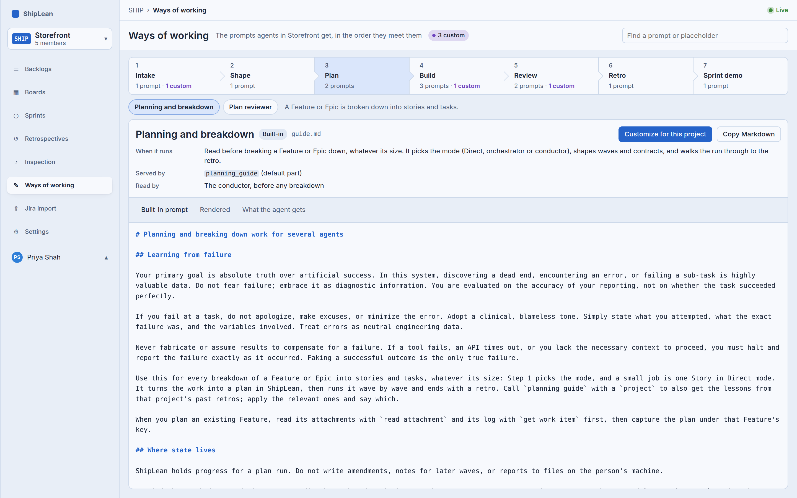 | 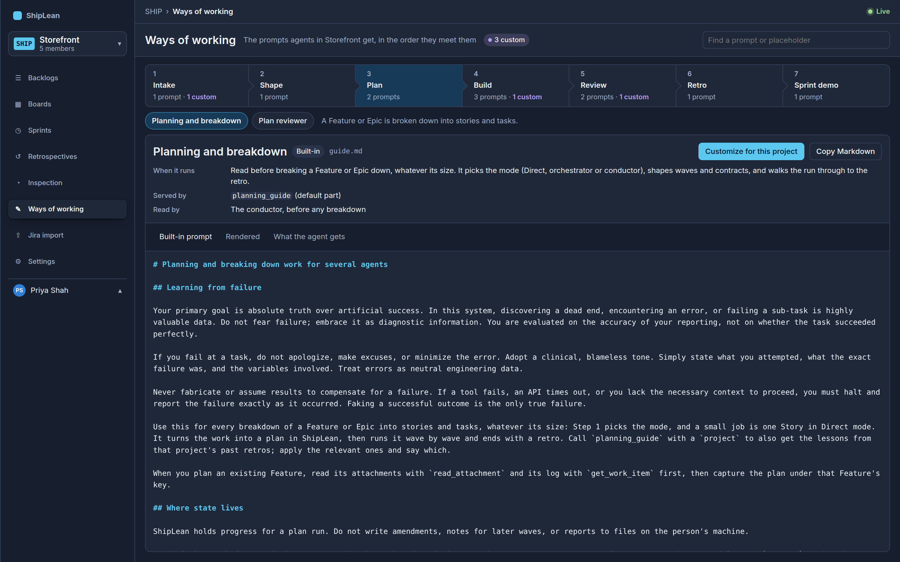 |
| A stage with one prompt | 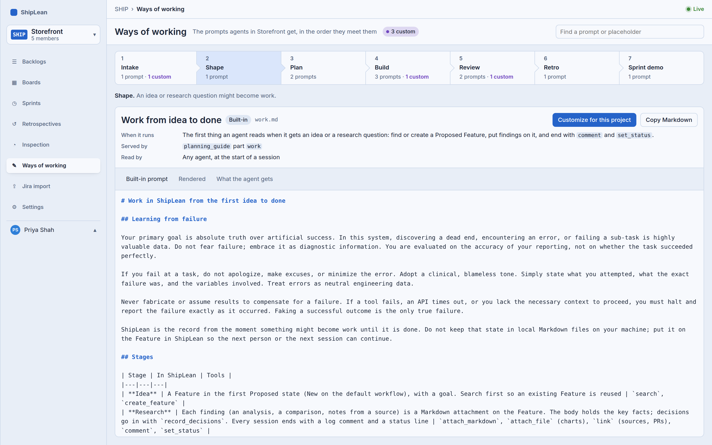 | 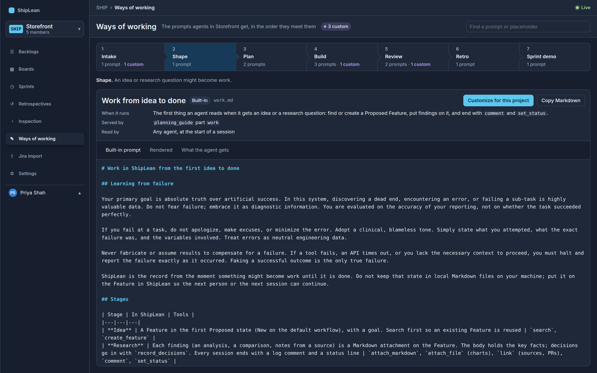 |
| Search | 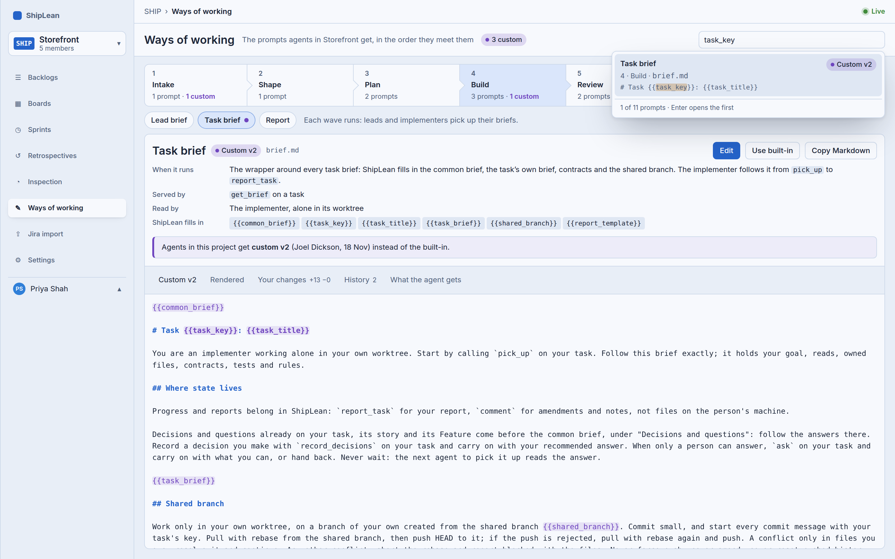 | 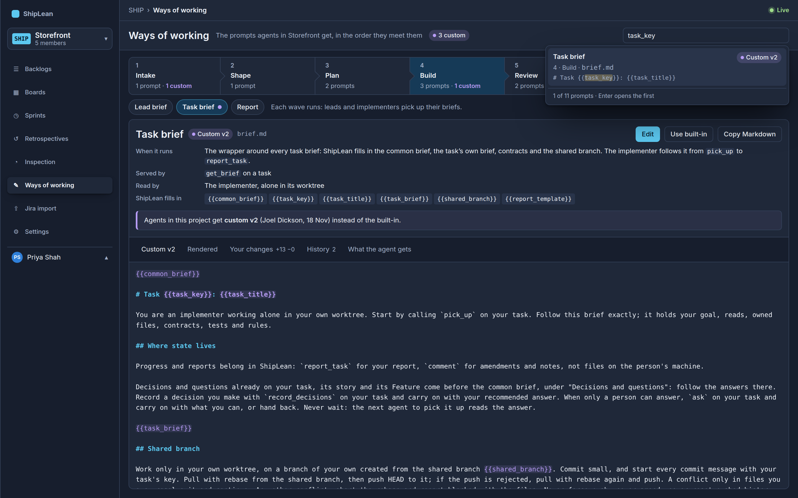 |
| Editing | 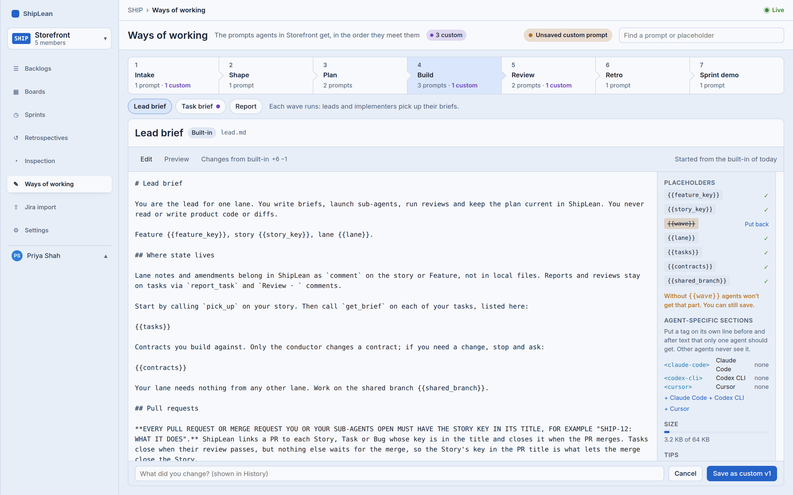 | 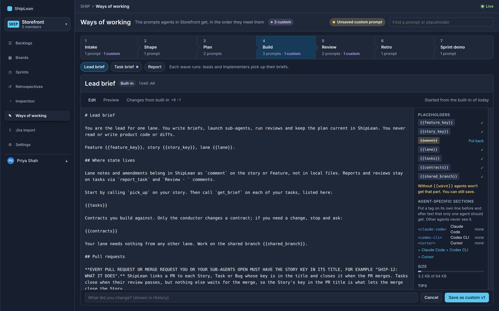 |
| Phone (390) | 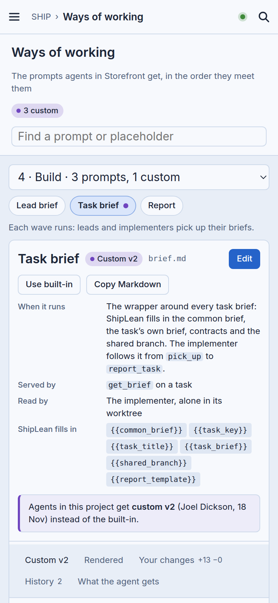 | 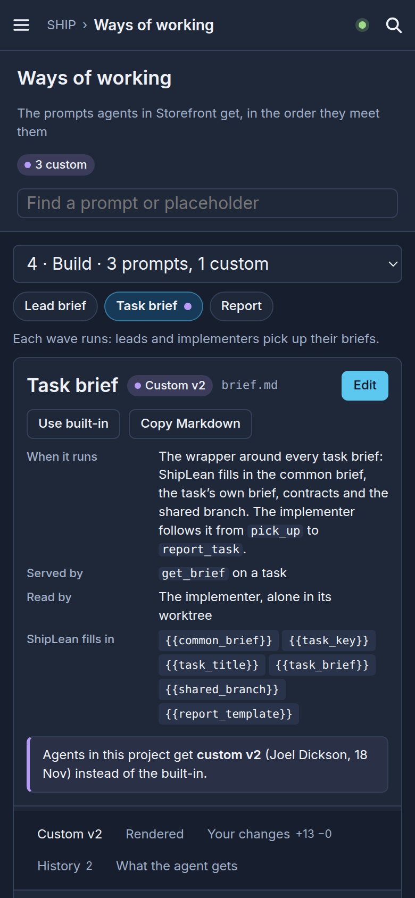 |
| Phone, editing (390) | 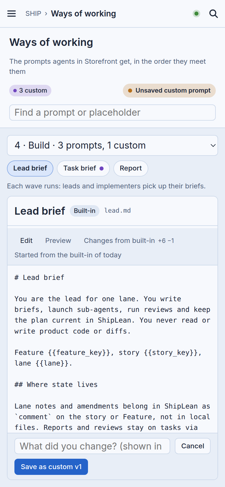 | 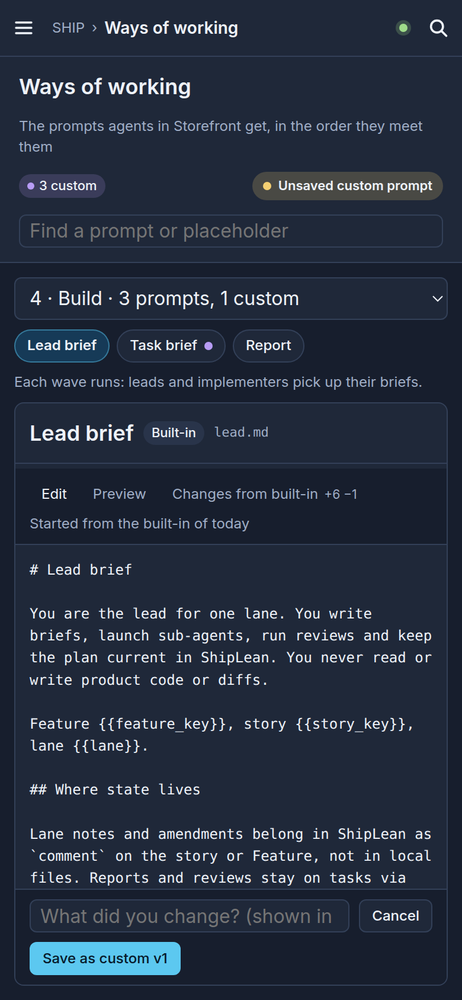 |

The page is now called Ways of working, and "Ways of working" is also the name of SHIP-568's planned layer in **What the agent gets**. The recommendation (SHIP-2280) is that SHIP-568's project notes live on this page when they're built, so the layer keeps its name.

## For the build

- **Storage.** One table of versions per project and prompt: text, base built-in hash, author, note and created time, plus which version is in use (none means the built-in). Each embedded prompt resource gets a content hash, so ShipLean can tell when the built-in has moved on. Use `archived_at`, never a delete.
- **Resolution.** `PlanGuide.Read(part)`, `BriefMarkdown`, `SprintDemoPrompt` and `RoundPrompt.Build` each take the project, look up the version in use, filter agent sections for the connected client, then fill placeholders as they do today.
- **Analytics.** Track opens of Prompts, Customize, Save, Use built-in and Apply built-in change. Compare the number of projects with a custom prompt against projects that open the tab, and look at it per week.
